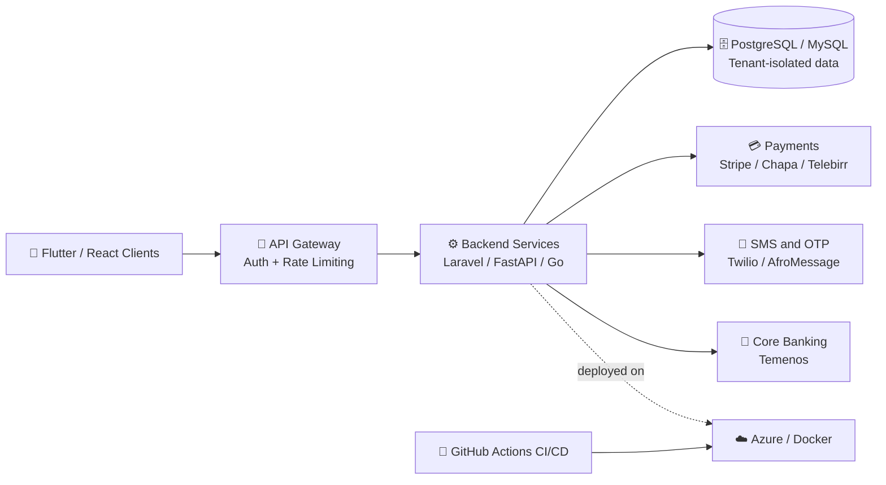

 

📍 Addis Ababa, Ethiopia &nbsp;·&nbsp; 🌍 **Available for remote work**

 

## 👋 About

Backend-focused engineer with **4+ years** of experience shipping production systems in **fintech, logistics, e-learning, HR-tech, SaaS and social platforms**. As a **Senior Backend Developer and Technical Lead**, I own architecture, cloud deployment and delivery, and I mentor the developers around me.

I also build and ship consumer products: **EthioLearn**, an exam-prep platform for grade 9 to 12 students and national exam candidates, and **FinCoach**, a money-management SaaS that tracks real cash flow from SMS.

<table>
<tr>
<td width="50%" valign="top">

### 🛠️ What I do

- Design REST and GraphQL APIs and database schemas
- Build multi-tenant SaaS with strict data isolation
- Integrate payments and core banking systems
- Ship real-time features: live tracking, chat, streaming
- Deploy and operate services on Azure with CI/CD

</td>
<td width="50%" valign="top">

### 🧭 How I work

- Architecture first, clean separation of concerns
- Security and reliability by default
- Production-ready code with automated delivery
- Clear communication with distributed, international teams
- Mentoring through code reviews and teaching

</td>
</tr>
</table>

 

## ⚡ Tech Stack

**Backend** 

**Mobile and Web** 

**Data** 

**Cloud and DevOps** 

**Integrations** 

 

## 🏗️ How I Typically Architect Systems

 

## 🚀 Featured Work

### 🏦 Financial and Banking Systems

| Project | Role | What I built | Stack |
|---|---|---|---|
| **YehuluSaccos** | Backend Lead | Full SACCO platform covering loans, savings, member and staff administration, integrated with **Temenos** core banking for accounts and transactions | Backend APIs, Temenos |
| **Hakim Express** · [🔗 Live](http://hakimexpress.com) | Backend Developer | USD to ETB remittance with real-time rate calculation, Stripe and Bank of Abyssinia integration, Twilio OTP verification, bank-grade security | FastAPI, Stripe, Twilio, Flutter |
| **FinCoach** | Full-Stack | Personal and business finance SaaS. Users track income and expenses, get guided money-management coaching, and see real cash flow built automatically from bank and mobile-money SMS | Flutter, Backend APIs |

### 🏢 SaaS and Enterprise Platforms

| Project | Role | What I built | Stack |
|---|---|---|---|
| **Performance Management SaaS** | System Architect, Backend | Multi-tenant evaluation platform with isolated company data, automated scoring, annual review cycles, feedback workflows and HR analytics | Laravel, React |
| **Beverage Distribution SaaS** | Backend Developer | Multi-tenant platform for distributors: orders, delivery routing, REST APIs for field agents, subscription and usage-based billing | Laravel, Filament |
| **E-Menu and Marketplace** | Full-Stack | Restaurant management plus public discovery marketplace, delivery and pickup flows with real-time order tracking | Full-stack |
| **Hotel and Cafe Ordering** · [🔗 Demo](https://etalem-cafe-system.vercel.app/self-orders/3) | Full-Stack | Ordering and billing, kitchen routing, table management, inventory, sales reporting, tablet-friendly POS | Laravel, Filament, React, MySQL |

### 📚 Education, Logistics and Consumer Apps

| Project | Role | What I built | Stack |
|---|---|---|---|
| **EthioLearn** | Full-Stack | Learning platform for Ethiopian grade 9 to 12 students. Textbooks with short notes, practice questions and realistic model exams, plus 20 years of past Grade 12 national exams | Flutter, Backend APIs |
| **Negadras Delivery** · [🔗 Live](https://negadrasexpress.com) | Backend and API | Merchant panel, driver app and customer app; Google Maps live tracking and routing; Chapa and Telebirr payments; SMS OTP via AfroMessage | Laravel, Flutter, Google Maps |
| **Faith Connect** | Full-Stack | Social platform with short video, live streaming, messaging and community features | Full-stack |
| **Noble Lemat Delivery** | Backend and API | Delivery and marketplace platform combining logistics with e-commerce | Backend APIs |
| **Real Estate Management** · [🔗 Live](https://betegbarpms.com) | Full-Stack | Property listings, client management and transaction tracking | Full-stack |

Additional work in private and organization repositories includes School Management and Hospital Management systems.

 

## 📊 GitHub Stats

 

## 💼 Experience

| Period | Role | Organization |
|---|---|---|
| **Feb 2026 – Present** | Senior Backend Developer and Technical Lead | Pitron Tech |
| Dec 2025 – Jan 2026 | Full-Stack Engineer (Contract) | Eagle Lion AI |
| Jan 2024 – Sep 2025 | Backend Developer (Remote) | Zulu Tech, top-rated Upwork agency |
| Sep 2023 – Present | Backend Lead and Full-Stack Developer *(concurrent)* | Helder Technological Solution |
| Feb 2024 – Feb 2026 | Part-Time Instructor | Admas University College |
| Sep 2021 – Present | Software Developer *(freelance)* | International clients |

🎓 **Education:** BSc Computer Science, Addis Ababa University &nbsp;·&nbsp; MSc Project Management (in progress), Maryland International College

 

### 🤝 Let's build something together

